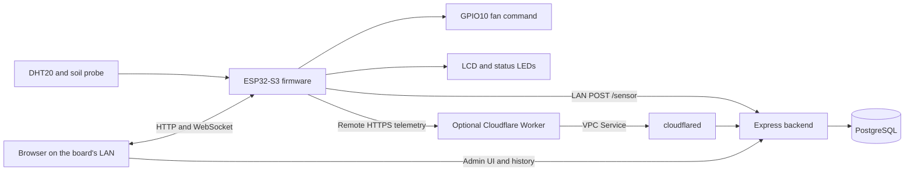
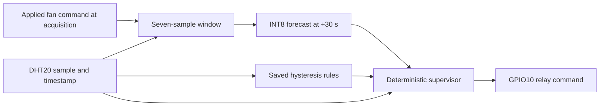

# ESP32-S3 Air Monitoring & Fan Control System

A Yolo Uno ESP32-S3 samples air temperature and humidity every five seconds. It displays readings locally, drives a ventilation fan and can forecast which temperature/humidity band will be reached in 30 seconds. A separate soil-moisture input is available for monitoring. The controller runs on the board. A Node.js service and PostgreSQL database add multi-device monitoring and history, with an optional Cloudflare route for remote access.

- **Start here** to clone the correct branch, run the backend locally without hardware, build the two ESP32 images and provision the board. [Getting started](GUIDE.md)
- **Work with sensor data** to interpret the model, train a candidate or import a device's history. [TinyML model and training](ml/README.md)
- **Verify a physical setup** to compare the requested mode, applied relay command and observed fan response. [Bench guide](ml/HIL.md)
- **Upgrade an existing installation** to back up the database, apply migrations and read the telemetry export contract. [Database guide](database/MIGRATIONS.md)

## System Architecture



The admin dashboard reads from PostgreSQL through the backend. Opening an embedded dashboard starts a separate connection from the browser to the board's LAN address. The device can keep sampling and controlling the relay while the backend is offline. The in-memory upload queue holds six payloads and discards the oldest when full.

---

## Hardware Pinout

| Component | GPIO / Bus | Configuration & Role |
| :--- | :--- | :--- |
| **ESP32-S3 (Yolo Uno)** | — | 240 MHz MCU, 8 MB Flash (`default_8MB.csv`), FreeRTOS + TFLite Micro |
| **DHT20 Sensor** | I2C (`SDA = GPIO11`, `SCL = GPIO12`) | Ambient temperature (°C) and relative humidity (%) |
| **Soil Moisture Sensor** | ADC (`SOIL_PIN = GPIO2`) | Independent ADC-derived moisture percentage for monitoring |
| **16×2 I2C LCD** | I2C (`0x27`, `SDA = 11`, `SCL = 12`) | Displays `T`, `H`, `SM`, and air-risk status |
| **Status LED** | `LED_GPIO = GPIO48` | Blinks according to temperature risk level |
| **NeoPixel WS2812B** | `NEO_PIN = GPIO45` (`LED_COUNT = 1`) | Displays RGB color according to humidity risk level |
| **Ventilation Fan (Relay)** | `FAN_PIN = GPIO10` | Active-HIGH relay output controlled by `task_fan` |
| **BOOT Button** | `BOOT_PIN = GPIO0` (`INPUT_PULLUP`) | Hold `> 2 s` for factory reset of network, server, and FAN config |

GPIO10 is the relay control signal. Use a fan driver and power supply rated for the fan's operating and starting current. The reported fan state is the command applied to GPIO10. Confirm motion or airflow on the physical fan.

GPIO2 maps 12-bit ADC values linearly to a percentage. The firmware treats rail readings of 0 and 4095 as invalid. The displayed percentage depends on the probe and substrate and needs calibration for a physical moisture measurement. Soil readings remain available when the DHT20 fails and are excluded from fan decisions, air-risk labels and model inputs.

The LCD and dashboards display temperature with one decimal place. Humidity uses tenths where needed and soil moisture uses whole percentages. The LCD fits both air readings on its first row and pads each row to 16 characters. The sensor task keeps the numeric values separately for control and telemetry. [Sensor formatting](firmware/include/sensor_format.h)

## Directory Structure

- `platformio.ini` selects the Yolo Uno board and maps PlatformIO to the `firmware/` directories. `boards/` contains the board definition, `src/` and `include/` implement the controller, `lib/` contains the LCD and inference libraries, and `data/` contains the dashboard files packaged into LittleFS.
- `services/backend/` contains the Express ingestion API, session handling, login and admin pages. `services/gateway/` holds the optional Cloudflare Worker and its VPC binding configuration.
- `database/schema/` and `database/migrations/` define PostgreSQL tables, access grants, sessions, display views and telemetry history. [Existing database upgrades](database/MIGRATIONS.md)
- `ml/` contains the model's feature definitions, training and export source, history importer, model manifest and bench guide. The firmware builds the shipped model and its metadata into the application image from `firmware/include/dht_fan_model.h` and `firmware/include/fan_model_metadata.h`. [Model and labeling workflow](ml/README.md)
- `tools/device/` contains the USB utility for recovering Wi-Fi settings from the board.
- `docker-compose.yml` defines PostgreSQL, the backend and tunnel connector. The public configuration templates are [the server environment](.env.example) and [the firmware header](firmware/include/secrets.h.example). Keep credentials, device exports and built images containing device secrets private.

## ESP32-S3 Firmware

### FreeRTOS Tasks

At startup the sensor task initializes the DHT20 and LCD, then displays these two 16-character rows for five seconds. The vertical bars mark the edges of the display.

```text
|   IOT    ENV   |
|  MONITOR  SYS  |
```

It then clears the screen and starts sampling. Row one shows temperature and air humidity. Row two shows soil moisture and the air-risk label. A new boot repeats the greeting. If it appears unexpectedly, inspect `[BOOT] reset_reason=...` and the build timestamp on the 115200-baud serial monitor. [Sensor task](firmware/src/environment_monitor.cpp)

The application starts seven FreeRTOS tasks at priority 2. [Startup sequence](firmware/src/main.cpp)

| Task Function | Stack (bytes) | Period / Trigger | Responsibility |
| :--- | :---: | :--- | :--- |
| `temp_humi_monitor` | `6144` | Every `5000 ms` | Reads DHT20 temperature, humidity and the soil ADC. Updates the LCD, publishes sensor JSON and signals changes to other tasks |
| `led_blinky` | `2048` | Phase delay / `semLEDUpdate` | Blinks `GPIO48` (`1000 ms`, `500 ms`, or `100 ms` per HIGH/LOW phase); adapts immediately when `semLEDUpdate` fires |
| `neo_blinky` | `2048` | Event-driven (`semNeoUpdate`) | Updates WS2812B (`GPIO45`) color only when `neoState` changes |
| `task_fan` | `4096` | Notification / `100 ms` timeout | Drives fan relay (`GPIO10`) in `AUTO`/`SHADOW`/`AI`/`MANUAL` with freshness, dwell and runtime protections; pushes WebSocket & DB events on state change |
| `tiny_ml_task` | `8192` | Polls every `100 ms` | Adds each new DHT sample to the temporal window and publishes inference status, scores and agreement with the current reference rule |
| `task_database` | `16384` | Event-driven (`semDBUpdate`) | Sends `POST /sensor` with `200 ms` per-source debounce and fan-event priority |
| `Task_Toggle_BOOT` | `4096` | Polled every `100 ms` | Triggers factory reset if `BOOT` (`GPIO0`) is held `> 2000 ms` |

The Arduino loop performs the following work and delays 30 ms between iterations.

- Executes live Wi-Fi switching (`Wifi_switch_to()`) when `g_wifiSwitchFlag` is raised.
- Services captive DNS and retries the saved station network periodically. A station connection attempt can wait up to ten seconds.
- Keeps the HTTP/WebSocket server active (`Webserver_reconnect()`) and services `ElegantOTA.loop()` through `Webserver_reconnect()`.

HTTP, WebSocket, and OTA handlers are registered once. Wi-Fi reconnects restart the listener without accumulating duplicate handlers.

---

### SharedContext & Synchronization

The sensor, inference, relay and telemetry tasks exchange readings, sample identity and status through `SharedContext`. Its fields are defined in [shared_context.h](firmware/include/shared_context.h).

- **`mutexContext`**: Guards multi-field snapshots of sensor readings, time and model results.
- **`xMutexFanControl`**: Guards `global_fan_state`, `global_fan_mode`, `fan_requested_mode`, `fan_manual_state`, decision reason, and the active `fan_config`.
- **`g_wifiSwitchMutex`**: Guards pending Wi-Fi switch credentials (`g_wifiSwitchSSID`, `g_wifiSwitchPass`, `g_wifiSwitchFlag`).
- **`serialLogLock()` / `serialLogUnlock()`**: Groups serial writes from cooperating tasks.

---

### Risk Classification Policy

The board uses separate temperature and humidity indicators. The status LED blinks with 1,000 ms per phase for 15–25 °C, 500 ms for the adjoining bands from 10 to below 15 °C or above 25 to 30 °C, and 100 ms outside those ranges. The NeoPixel is green for 60–70% RH, yellow for the adjoining bands from 50 to below 60% or above 70 to 80%, and red outside those ranges. The indicators take their last classified values through a failed DHT read.

The LCD air-risk label combines the piecewise temperature and humidity penalties with weights 7/11 and 4/11. The weighted result is Normal at or below 3, Warning above 3 through 6.5, and Critical above 6.5. A temperature of at least 40 °C or relative humidity of at least 90% selects Critical directly. On a failed DHT read the LCD displays `No data`. The firmware sends the label in `Message` for a valid fresh DHT sample and JSON null otherwise. Fan control uses its own saved thresholds. [Risk policy](firmware/include/risk_policy.h)

### TinyML Inference

Each prediction answers “Which reference band will this environment occupy in 30 seconds?” The forecast assumes the sampled fan command persists. The bands are ON at or above either upper threshold, OFF at or below both lower thresholds, and HOLD elsewhere. Current and future bands can differ even with the same instantaneous reading.

- A rolling window holds seven successive valid DHT20 samples, spanning 30 seconds at the nominal period. A zero interval or a gap over eight seconds restarts the window. The feature extractor uses acquisition timestamps to calculate the slope of a fitted line and the latest rate of change for temperature and humidity. The eight inputs are current T and RH, both fitted slopes, both latest rates, the combined residual variation about the trends, and the GPIO command at acquisition.
- Feature extraction uses floating-point arithmetic. TensorFlow Lite Micro quantizes the features, invokes the INT8 FullyConnected and Softmax kernels in a 4 KiB static arena, and decodes three scores in OFF, HOLD, ON order. The model manifest records the byte count, quantization scales and tensor dimensions.
- A broken sequence, expired sample, invalid DHT read, or excursion outside the model domain (5–50°C, 20–100% RH) restarts the history. Seven good samples restore inference. The controller checks sample identity and freshness at actuation.
- SHADOW applies the saved control rule and publishes the forecast alongside the relay decision. AI allows an early ON inside the reference hysteresis band when the model is ready, the saved profile matches and the largest INT8 softmax score is at least 0.80. The supervisor enforces the hard ON/OFF thresholds, dwell and fault handling described below.
- The device API, WebSocket and history expose the version, acquisition and decision identifiers, window count, trend slopes, proposal, scores and reason. Online agreement counts how often the proposal matches the **current** static reference. Evaluating forecast accuracy requires observing the **future** band. [Training and evaluation](ml/README.md) · [Hardware bench procedure](ml/HIL.md)

The fan task owns the GPIO write. Its decision includes a reason such as `rule_on`, `ai_proactive_on`, `min_on_time` or `sensor_invalid`. [Fan policy](firmware/include/fan_policy.h)



---

### Fan Control & Safety Interlocks

The fan task starts with GPIO10 low and the requested mode set to AUTO. It records the applied GPIO state, mode, reason and decision sample sequence. An HTTP 202 acknowledges a control request. Read `/api/status` or the next device update to confirm the applied decision. [Fan task](firmware/src/fan.cpp)

- **AUTO** uses four thresholds saved in **Settings → Fan**. Each OFF threshold must be strictly below its ON threshold. Temperature values must lie within −40 to 80 °C and relative humidity within 0 to 100%. With OR logic, either high threshold starts the fan and both low thresholds stop it. With AND logic, both high thresholds start it and either low threshold stops it. Between those limits the controller preserves its previous decision.
- **SHADOW** applies the AUTO rules and records the independent TinyML proposal for comparison. Both SHADOW and AI require a valid saved configuration.
- **AI** can start ventilation early in the intermediate band. The shipped model requires the OR profile with temperature ON/OFF at 30/28 °C and relative humidity ON/OFF at 75/70%. A ready forecast for the current sample with a top score of at least 0.80 can request early ON. Reaching an upper threshold requests ON and reaching both lower thresholds requests OFF. A different profile or an unusable forecast falls back to the saved AUTO rules.
- **MANUAL** accepts explicit ON or OFF commands without the automatic sensor and dwell conditions. A continuous manual ON run ends after five minutes. A new ON request starts a new run.

In automatic modes the controller holds the relay OFF until it has a valid configuration and DHT20 sample. Readings older than 15 seconds are stale. Normal switches have a ten-second minimum ON/OFF dwell. Sensor loss or unavailable control forces OFF. An automatic mode or configuration change restarts the OFF dwell. On reboot the board reloads the saved thresholds and selects AUTO. [Control policy](firmware/include/fan_policy.h)

### Wi-Fi, Captive Portal & Embedded Web Server

With no saved station credentials the board starts a setup access point at `192.168.4.1` using `SSID_AP` and `PASS_AP`. Captive DNS directs clients to the setup page. A station connection attempt can take ten seconds. After a failed attempt the board starts the access point and retries the saved network at intervals of at least 15 seconds. On connection it configures SNTP with `pool.ntp.org` and `time.nist.gov`.

Access to the password-protected Wi-Fi network grants access to the provisioning page in AP mode. On the station network, protected routes accept the configured HTTP credentials or an `iot_ticket` cookie. Opening `/?ticket=...` exchanges a valid backend-signed HMAC-SHA256 ticket for this HttpOnly cookie. Verification checks the board MAC, LAN IP and expiry with the synchronized clock. The WebSocket accepts a one-time token from `/api/ws-token` in an initial `{"page":"auth","token":"..."}` message. OTA uses the configured device HTTP credentials. [Device web server](firmware/src/web_server.cpp)

**Device HTTP routes on port 80**

- `GET /` exchanges a valid `?ticket=...` for an `HttpOnly` cookie and redirects to the dashboard. Both `/` and `/dashboard.html` serve the authenticated page in station mode.
- `GET /api/status` — Returns AP mode and applied GPIO `fan_state` / `fan_mode`, reason and decision sample/time.
- `GET /api/ai-status` — Returns the sensor/model snapshot plus the applied fan state and decision identifiers. Compare sample sequences to associate an asynchronous fan decision with its acquisition.
- `GET /api/fan-config` — Returns the saved AUTO thresholds and activation logic; before configuration, `configured` is `false` and all four thresholds are `null`.
- `POST /api/fan-config` — Validates and persists `{temperature_on, temperature_off, humidity_on, humidity_off, activation_logic}` and returns the saved configuration with `configured: true`. Uses the same device authentication as relay controls.
- `GET /api/ws-token` — Issues a 30-second one-time token for authenticating `/ws`.
- `GET /toggle-fan?state=ON|OFF` — Switches to `MANUAL` mode and queues the requested fan state (`202 Accepted`); the fan task applies the relay output.
- `GET /set-mode?mode=AUTO|SHADOW|AI|MANUAL` — Acknowledges a requested mode (202); applied mode is reported by the controller. AI/SHADOW require a saved valid fallback configuration.
- `GET /api/wifi-list` — Lists saved SSIDs from `/wifi_list.json` (passwords omitted).
- `POST /api/wifi-switch` — Queues live Wi-Fi network switching (`{ssid, pass}`).
- `GET /api/server-url` — Returns current `g_sensorApiUrl`.
- `/update` — ElegantOTA firmware/filesystem update UI (HTTP Basic Auth).

---

### LittleFS Storage & Factory Reset

| LittleFS Path | Purpose |
| :--- | :--- |
| `/dashboard.html`, `/dashboard.css`, `/dashboard.js` | Device dashboard page and its public CSS/JavaScript. Direct static requests for saved configuration files are filtered. |
| `/info.dat` | Active Wi-Fi JSON (`WIFI_SSID`, `WIFI_PASS`, `STA_IP`) |
| `/wifi_list.json` | Saved Wi-Fi credentials (new SSIDs are prepended and existing entries are updated in place) |
| `/fan.json`, `/fan.json.tmp` | Saved FAN AUTO thresholds and OR/AND activation logic plus the temporary save file; both are blocked from direct static access |
| `/server.json` | Optional runtime override `{"url": "https://..."}` for `SENSOR_API_URL` |

Holding GPIO0 low for more than two seconds while the application runs clears saved Wi-Fi, server and fan settings and restarts the board. The next boot opens the setup access point. Uploading a LittleFS image also replaces stored settings. The firmware enables formatting on mount failure. [Storage implementation](firmware/src/device_config.cpp)

---

## Backend, Database & Edge Gateway

### Backend API Endpoints

Implemented in `services/backend/src/index.js` (Express 5, port `3000`):

| Endpoint | Method | Auth | Description |
| :--- | :---: | :---: | :--- |
| `/healthz` | `GET` | — | Database connectivity health check (`200` / `503`) |
| `/sensor` | `POST` | `X-Device-Key` | Validates and inserts ESP32 telemetry into `sensor_logs` |
| `/login` | `GET` / `POST` | — | Login page & rate-limited session login (`express-session`) |
| `/logout` | `POST` | — | Destroys active session |
| `/api/me` | `GET` | — | Returns `loggedIn`, with `username` and `role` for a signed-in account |
| `/admin/*` | `GET` | Logged in | Serves static Admin Dashboard (`admin.html`, `admin.css`, `admin.js`) |
| `/admin/api/history` | `GET` | Logged in | Device/LAN-scoped paginated experiment history, optional time filters; see [migration and history contract](database/MIGRATIONS.md) |
| `/admin/api/devices` | `GET` | Logged in | Latest record & online age per `(device_id, lan_ip)` filtered by RBAC |
| `/admin/api/devices/:device_id` | `DELETE` | Admin | Deletes logs for a device, optionally scoped by `?lan_ip=...` |
| `/admin/api/devices/:device_id/ticket` | `POST` | Logged in | Verifies device password & returns a 5-minute HMAC ticket |
| `/admin/api/devices/:device_id/has-password` | `GET` | Admin | Checks whether a device password is set |
| `/admin/api/devices/:device_id/password` | `POST` / `DELETE` | Admin | Sets/updates or removes a device password (`bcrypt`) |
| `/admin/api/devices/:device_id/access-request` | `POST` | User | Requests temporary admin approval for a passwordless device |
| `/admin/api/access-requests` | `GET` | Admin | Lists pending temporary device access requests |
| `/admin/api/access-requests/:id/status` | `GET` | User | Polls request decision and receives HMAC ticket upon approval |
| `/admin/api/access-requests/:id/decision` | `POST` | Admin | Approves or denies a pending access request |
| `/admin/api/users` | `GET` / `POST` | Admin | Lists system accounts or creates a new `admin` / `user` account |
| `/admin/api/users/:id/devices` | `GET` / `PUT` | Admin | Reads or updates `(device_id, lan_ip)` access grants for a `user` |

---

### PostgreSQL Schema & Migrations

Configured for **PostgreSQL 18** (`timezone=Asia/Ho_Chi_Minh`):

- **`sensor_logs`** (`database/schema/base.sql`): Stores `id`, `timestamp_real`, `timestamp_up`, `received_at`, numeric `temperature`, `humidity`, optional `soil_moisture` (`0..100` or `null`), `"FAN_state"`, `"MODE_state"`, `"Message"`, `"Score"`, `device_id` (MAC), `lan_ip`, `latency` (µs), and `trigger_source` (`sensor` | `fan` | `ai`), plus `boot_id`, `sample_seq`, `sampled_uptime_ms`, `ai`, `fan_reason`, `fan_config`, `fan_decision_sample_seq` and `fan_decided_uptime_ms`. Retention uses the server receipt time, falling back to upload time for older rows. Cleanup runs at startup and every six hours. `SENSOR_RETENTION_DAYS` defaults to 30 and setting it to 0 disables automatic deletion. The firmware sends `Score: null` and writes model scores to `ai.probabilities`. Its `latency` field measures acquisition-to-payload preparation on the device.
- **`device_credentials`** (`database/schema/base.sql`): Stores per-device `bcrypt` password hashes (`device_id` PK).
- **`system_users` & `user_devices`** (`database/migrations/001_auth.sql`): Stores `admin`/`user` accounts and per-user `(device_id, lan_ip)` permissions.
- **`session`** (`database/migrations/003_session_login_at.sql`): Persistent PostgreSQL session store (`connect-pg-simple`) with `login_at` timestamp.
- **`display.*` views** (`database/migrations/004_time_display_views.sql`): Read-only views formatting all timestamps as `YYYY-MM-DD HH24:MI:SS` in `Asia/Ho_Chi_Minh`.
- **`005_ai_telemetry.sql`**: Additive experiment metadata and display-view refresh; see [database/MIGRATIONS.md](database/MIGRATIONS.md) for existing volumes.
- **`002_timezone.sql`**: Standalone migration helper for upgrading legacy `timestamp without time zone` installations.

---

### Authentication, RBAC & HMAC Device Tickets

- **Password Security**: New backend account passwords and per-device dashboard passwords are hashed with bcrypt at cost 10. Successful verification can upgrade a legacy plaintext record. Direct HTTP login on the ESP32 uses separate firmware credentials. The backend rate-limits failed sign-in and ticket-password attempts.
- **Role-based access**
  - **`admin`**: Full visibility across all devices, bulk log deletion, device password management, user creation, `(device_id, lan_ip)` grant assignment, and approval of passwordless access requests.
  - A **user** can view granted devices. A grant can match a specific LAN IP or cover all IPs for a device. For LAN access, the user enters a per-device dashboard password or requests approval from an administrator. The backend issues a five-minute HMAC ticket after verification or approval.

---

### Cloudflare Tunnel & Worker Gateway

- The `cloudflared` connector opens an outbound tunnel to the Docker network. In the supplied Compose configuration the backend listens on internal port 3000 and PostgreSQL publishes port 5433 on host loopback.
- The Worker in `services/gateway/` forwards requests through `env.IOT_BACKEND` and sets `X-Forwarded-Proto` and `X-Forwarded-Host` for the origin. Device-to-backend HTTP sends the shared key in clear text. The firmware HTTPS client encrypts traffic with server certificate verification disabled. Use the device and backend on trusted networks. [Telemetry transport](firmware/src/telemetry_client.cpp)

---

## Dashboards

### Embedded Device Dashboard

- **Dashboard** (`#dashboard`) displays temperature, air humidity, soil moisture, a clock, the air-risk notification and applied fan/mode badges. Its 60-point chart can add a reading every five or fifteen seconds and has a local canvas fallback. The map shows a fixed marker and uses online tiles. [Device dashboard](firmware/data/dashboard.html)
- **Settings → WiFi** (`#settings/wifi`) manages credentials, saved-network switching and the backend URL.
- **Settings → Fan** (`#settings/fan`) exposes the four thresholds, OR/AND logic, requested mode and manual ON/OFF. Its badges and reason report the applied decision.
- **Settings → TinyML** (`#settings/tinyml`) shows window fill, fitted slopes, reference class, forecast, scores, model version and sample identity. An expired or mismatched result clears the current proposal.

### Central Admin Dashboard

The backend serves the login and admin pages. The admin dashboard polls every five seconds for the latest row per device and LAN IP. It displays device and sample freshness, exports a time range as JSONL, and lets an administrator manage accounts, grants, per-device passwords and access requests. A user can open an authorized board from a browser that can reach its LAN IP. [Admin dashboard](services/backend/public/admin/admin.html)

## TinyML Training Pipeline

The training script generates independent synthetic trajectories and labels each window using the simulated temperature and humidity 30 seconds later. It fits the network, calibrates INT8 quantization from training samples and evaluates the exported model against the current band, a linear forecast and the most frequent training class. The bundled 5,536-byte model is identified by `fan-trend-int8-v2-8abd0b91c744`. Its manifest reports 87.28% desktop INT8 accuracy on 3,600 synthetic test episodes, 71.03% for the instantaneous band and 82.94% for 30-second linear extrapolation. These figures describe the simulator. Training writes a feature CSV, portable model, JSON manifest and two firmware headers under the selected output directory. The repository ships the two headers and the matching manifest, so PlatformIO can compile the model directly. [Model manifest](ml/models/fan_model_manifest.json)

For field evaluation, export JSONL for one device from the admin dashboard and match each reading and fan decision by boot and sample sequence. The import tool can build labeled windows from subsequent observations in a continuous session. Independent sessions and physical measurements are needed to evaluate forecasting and ventilation in the enclosure. [Training and history import](ml/README.md) · [Bench procedure](ml/HIL.md)

## Device Utility Tools

`tools/device/pull_wifi_info.py` reads the LittleFS partition over USB and combines the saved Wi-Fi list with the active station IP, when available. It writes SSIDs, saved Wi-Fi passwords and available station IP values to the ignored path `local/device/wifi_info.json`. [Installation and usage](GUIDE.md#8-optional-workstation-tools)

## Installation & Deployment

Use the setup guide for the local PostgreSQL and Node workflow, the Cloudflare deployment route, firmware and LittleFS uploads, and on-device verification. The migration guide covers existing database volumes. [Setup guide](GUIDE.md) · [Database upgrades](database/MIGRATIONS.md)

## Libraries & Runtime Versions

- **Firmware** uses PlatformIO environment `yolo_uno`, Arduino on `espressif32@7.1.3`, LittleFS, the local LCD driver and the bundled TensorFlow Lite Micro sources. PlatformIO resolves the pins for ESPAsyncWebServer, ArduinoJson, ElegantOTA, Adafruit NeoPixel and DHT20. [PlatformIO configuration](platformio.ini)
- **Backend and gateway** declare Node `>=26.12.0 <27` and npm `>=12.2.0 <13`. The development Node pin is 26.12.0. Use `npm ci` in the chosen service directory to install its lockfile. The backend uses Express 5 and PostgreSQL 18. The optional Worker uses Wrangler 4. [Backend manifest](services/backend/package.json) · [Gateway manifest](services/gateway/package.json) · [Compose services](docker-compose.yml)
- **Training and device utilities** have separate Python requirements. Python 3.12 is the reference training environment. NumPy, TensorFlow CPU and Keras support training and export. The USB reader uses esptool and littlefs-python. [Training dependencies](ml/requirements.txt) · [USB reader dependencies](tools/device/requirements.txt)

## License notices

The root license file contains the MIT license. The backend package declares ISC in its npm metadata. Bundled firmware libraries carry their upstream notices in the source tree. [Root license](LICENSE) · [Backend package metadata](services/backend/package.json) · [FlatBuffers notice](firmware/lib/TensorFlowLite_ESP32/src/third_party/flatbuffers/LICENSE.txt) · [gemmlowp notice](firmware/lib/TensorFlowLite_ESP32/src/third_party/gemmlowp/LICENSE)
