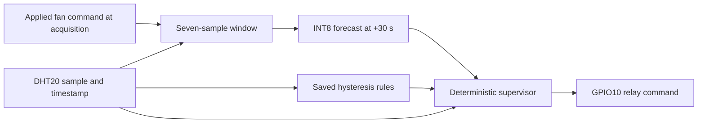

# ESP32-S3 Air Monitoring & Fan Control System

A real-time IoT air monitoring and fan control system running on the **ESP32-S3 (Yolo Uno)** microcontroller, paired with a containerized **Node.js + PostgreSQL** backend, **Cloudflare Tunnel / Worker Gateway**, and an on-device **full-integer INT8 TinyML** classifier that predicts the temperature/humidity band 30 seconds ahead under the current fan command. An independent soil-moisture channel provides additional monitoring.

> **Try the embedded AI on your laptop.** Replay two traces ending at **28.5°C / 71% RH**. A rising trace calls for early ventilation while a falling trace keeps the fan off. The replay uses the same model bytes, microcontroller kernels and relay policy as the firmware. [Reproducible demo and six bench tests (Tiếng Việt)](ml/HIL.vi.md)

> **New to this repository?** Read [GUIDE.md](GUIDE.md) for a complete step-by-step onboarding, environment setup, execution, and verification guide.

---

## Table of Contents

- [Overview](#overview)
- [System Architecture](#system-architecture)
- [Hardware Pinout](#hardware-pinout)
- [Directory Structure](#directory-structure)
- [ESP32-S3 Firmware](#esp32-s3-firmware)
  - [FreeRTOS Tasks](#freertos-tasks)
  - [SharedContext &amp; Synchronization](#sharedcontext--synchronization)
  - [Risk Classification Policy](#risk-classification-policy)
  - [TinyML Inference](#tinyml-inference)
  - [Fan Control &amp; Safety Interlocks](#fan-control--safety-interlocks)
  - [Wi-Fi, Captive Portal &amp; Embedded Web Server](#wi-fi-captive-portal--embedded-web-server)
  - [LittleFS Storage &amp; Factory Reset](#littlefs-storage--factory-reset)
- [Backend, Database &amp; Edge Gateway](#backend-database--edge-gateway)
  - [Backend API Endpoints](#backend-api-endpoints)
  - [PostgreSQL Schema &amp; Migrations](#postgresql-schema--migrations)
  - [Authentication, RBAC &amp; HMAC Device Tickets](#authentication-rbac--hmac-device-tickets)
  - [Cloudflare Tunnel &amp; Worker Gateway](#cloudflare-tunnel--worker-gateway)
- [Dashboards](#dashboards)
  - [Embedded Device Dashboard](#embedded-device-dashboard)
  - [Central Admin Dashboard](#central-admin-dashboard)
- [TinyML Training Pipeline](#tinyml-training-pipeline)
- [Device Utility Tools](#device-utility-tools)
- [Installation &amp; Deployment](#installation--deployment)
- [Libraries &amp; Runtime Versions](#libraries--runtime-versions)

---

## Overview

Every **5 seconds**, each ESP32-S3 node samples **temperature**, **air humidity**, and an independent **soil-moisture** channel, then coordinates local actuation, edge inference, and telemetry reporting:

1. **16×2 I2C LCD (`0x27`)** displays live `T`, `H`, `SM`, and air-risk status (`Normal` / `Warning` / `Critical`).
2. **Status LED (`GPIO48`)** blinks at a period determined by temperature risk (`Normal` 1000 ms, `Warning` 500 ms, `Critical` 100 ms per phase).
3. **WS2812B NeoPixel (`GPIO45`)** updates color on state transitions according to air humidity risk (Green / Yellow / Red).
4. **Ventilation Fan (`GPIO10`)** operates in `AUTO` (configured rules), `SHADOW` (rules plus AI observation), `AI` (model proposal with rule fallback), or `MANUAL` (5-minute cutoff). Automatic switching has a 10-second minimum ON/OFF duration; invalid sensors force automatic OFF immediately.
5. **TinyML (TensorFlow Lite Micro)** uses seven DHT20 samples and the applied fan command to forecast the future OFF / HOLD / ON region. The supervisor can accept a confident early ON between the configured thresholds.
6. **Embedded Web Server (`port 80` + `/ws`)** serves the local Device Dashboard over LittleFS to authenticated clients and supports browser-based OTA updates (`/update`).
7. **Telemetry Client** posts JSON payloads (`X-Device-Key`) over HTTP/HTTPS to the Node.js backend (`POST /sensor`), which stores records in **PostgreSQL 18** for multi-device monitoring via the **Admin Dashboard**.

---

## System Architecture

```text
┌──────────────────────────────────────────────────────────────────────┐
│                        ESP32-S3 (Yolo Uno)                           │
│                                                                      │
│  FreeRTOS Tasks (priority 2)          SharedContext + Mutex/Sem      │
│  ├── temp_humi_monitor (6144B)  ───►  temperature, humidity          │
│  ├── led_blinky        (2048B)  ◄───  dhtSampleValid, dhtSampledAtMs │
│  ├── neo_blinky        (2048B)  ◄───  ledState, neoState, lcdState   │
│  ├── task_fan          (4096B)  ◄──►  MlResult, pending FAN/AI events│
│  ├── tiny_ml_task      (8192B)  ◄──►  timestampReal / timestampRealUs│
│  ├── task_database    (16384B)  ◄───  sem{LED,Neo,DB}Update          │
│  └── Task_Toggle_BOOT  (4096B)                                       │
│                                    soilMoisture, soilSampleValid     │
│                                                                      │
│  LittleFS: /dashboard.{html,css,js}, /info.dat, /wifi_list.json,     │
│            /server.json, /fan.json                                   │
│  ESPAsyncWebServer (:80) + Authenticated WebSocket (/ws) + ElegantOTA│
└──────────────────┬───────────────────────────────────┬───────────────┘
                   │ HTTPS POST /sensor                │ LAN HTTP / WS
                   │ (Header: X-Device-Key)            │ (HMAC Ticket or Basic Auth)
                   ▼                                   ▼
┌──────────────────────────────────────┐     ┌─────────────────────────┐
│ Cloudflare Worker Gateway (optional) │     │ Browser (Same LAN)      │
│ services/gateway (VPC Service proxy) │     │ Embedded Device UI      │
└──────────────────┬───────────────────┘     └─────────────────────────┘
                   │ cloudflared tunnel                ▲ ?ticket=<HMAC>
                   ▼                                   │
┌──────────────────────────────────────────────────────┴───────────────┐
│                   Docker Compose Stack (iot_net)                     │
│  ├── cloudflared : Cloudflare Tunnel connector                       │
│  ├── backend     : Node.js + Express 5 (:3000, Admin UI + REST API)  │
│  └── postgres    : PostgreSQL 18 (iot_db, Asia/Ho_Chi_Minh)          │
└──────────────────────────────────────────────────────────────────────┘
```

---

## Hardware Pinout

| Component                         | GPIO / Bus                                 | Configuration & Role                                                   |
| :-------------------------------- | :----------------------------------------- | :--------------------------------------------------------------------- |
| **ESP32-S3 (Yolo Uno)**     | —                                         | 240 MHz MCU, 8 MB Flash (`default_8MB.csv`), FreeRTOS + TFLite Micro |
| **DHT20 Sensor**            | I2C (`SDA = GPIO11`, `SCL = GPIO12`)   | Ambient temperature (°C) and relative humidity (%)                    |
| **Soil Moisture Sensor**    | ADC (`SOIL_PIN = GPIO2`)                 | Independent ADC-derived moisture percentage for monitoring             |
| **16×2 I2C LCD**           | I2C (`0x27`, `SDA = 11`, `SCL = 12`) | Displays `T`, `H`, `SM`, and air-risk status                     |
| **Status LED**              | `LED_GPIO = GPIO48`                      | Blinks according to temperature risk level                             |
| **NeoPixel WS2812B**        | `NEO_PIN = GPIO45` (`LED_COUNT = 1`)   | Displays RGB color according to humidity risk level                    |
| **Ventilation Fan (Relay)** | `FAN_PIN = GPIO10`                       | Active-HIGH relay output controlled by `task_fan`                    |
| **BOOT Button**             | `BOOT_PIN = GPIO0` (`INPUT_PULLUP`)    | Hold `> 2 s` for factory reset of network, server, and FAN config    |

The optional soil channel maps raw ADC `[0..4095]` linearly to `[0..100]%`; rail readings `0` and `4095` are invalid. Calibrate the probe, substrate, and dry/wet endpoints before interpreting this ADC-derived percentage as physical soil moisture. Soil measurements appear on the LCD, dashboards, chart, and telemetry independently of DHT validity. They do not enter FAN control, air-risk labels, or TinyML inputs. Missing or stale DHT data produces telemetry `Message: null`; the dashboard clears the air-risk banner to `--` when a sensor snapshot has incomplete DHT values or an unavailable risk label, while valid soil data continues to display.

Sensor displays use the same formatting on the LCD, dashboards, chart tooltips, and sensor serial output: temperature has one decimal (`31.08 → 31.1°C`); air humidity is rounded to one decimal when needed (`61.34 → 61.3%`, `60 → 60%`), with endpoints `00%` and `100%`; soil moisture is an integer with at least two digits (`0 → 00%`, `5 → 05%`, `100 → 100%`). Rounding applies to display text; numeric readings, FAN thresholds, and TinyML inputs keep their precision. Missing data keeps its placeholder. LCD rows stay within 16 characters, removing the space between the T/H fields when necessary to retain both units.

---

## Directory Structure

```text
IoT-Env-Monitor/
├── database/
│   ├── MIGRATIONS.md                     # Existing-volume upgrade and experiment API
│   ├── schema/
│   │   └── base.sql                       # Core tables: sensor_logs, device_credentials
│   └── migrations/
│       ├── 001_auth.sql                   # system_users & user_devices (RBAC)
│       ├── 002_timezone.sql               # Legacy timestamp -> timestamptz conversion
│       ├── 003_session_login_at.sql       # Express session table + login_at column
│       ├── 004_time_display_views.sql     # Read-only display.* views in Vietnam time
│       └── 005_ai_telemetry.sql           # Additive AI metadata and view refresh
├── firmware/
│   ├── boards/
│   │   └── yolo_uno.json                  # Custom PlatformIO board manifest (ESP32-S3 8MB)
│   ├── data/                              # LittleFS web assets (uploaded via uploadfs)
│   │   ├── dashboard.html
│   │   ├── dashboard.css
│   │   └── dashboard.js
│   ├── include/
│   │   ├── device_config.h                # LittleFS config & Wi-Fi credential persistence
│   │   ├── dht_fan_model.h               # Embedded fan action TFLite model (alignas(16))
│   │   ├── fan_model_metadata.h           # Generated profile/domain/version/hash
│   │   ├── temporal_window.h              # Fixed-size time window and trend features
│   │   ├── fan_inference.h                # INT8 Micro interpreter and quantization
│   │   ├── fan_predictor.h                # Contiguous sample processing, model and status
│   │   ├── ml_result.h                    # Portable AI result and freshness helpers
│   │   ├── ai_telemetry.h                 # Shared JSON serialization
│   │   ├── environment_monitor.h          # LCD startup, sensor polling, WebSocket broadcast task
│   │   ├── factory_reset.h                # BOOT button long-press reset task
│   │   ├── input_safety.h                 # Sanitization, frame checks, freshness helpers
│   │   ├── message_handler.h              # Authenticated WebSocket command dispatcher
│   │   ├── fan.h                          # Fan state & mutex declarations
│   │   ├── fan_config.h                   # Dashboard FAN configuration and persistence
│   │   ├── fan_policy.h                   # Temperature/humidity hysteresis and manual cutoff
│   │   ├── rgb_led.h                      # NeoPixel task declaration
│   │   ├── risk_policy.h                  # Rule-based risk labels, independent of FAN
│   │   ├── secrets.h.example              # Template for firmware/include/secrets.h
│   │   ├── sensor_format.h                # Shared sensor text formatting for LCD and serial output
│   │   ├── serial_log.h                   # Mutex-protected Serial logging
│   │   ├── shared_context.h               # SharedContext struct & Wi-Fi switch sync primitives
│   │   ├── status_led.h                   # Single LED blink task declaration
│   │   ├── telemetry_client.h             # HTTP/HTTPS backend telemetry task declaration
│   │   ├── tinyml.h                       # TinyML task declaration
│   │   ├── web_server.h                   # Embedded HTTP/WS/OTA server interface
│   │   └── wifi_manager.h                 # STA/AP/Captive DNS/SNTP manager
│   ├── lib/
│   │   ├── lcd_i2c/                       # Local LiquidCrystal_I2C driver
│   │   └── TensorFlowLite_ESP32/           # Vendored TinyML runtime
│   └── src/                               # Firmware C++ implementations
│       ├── main.cpp
│       ├── device_config.cpp
│       ├── environment_monitor.cpp
│       ├── factory_reset.cpp
│       ├── message_handler.cpp
│       ├── fan.cpp
│       ├── fan_config.cpp
│       ├── rgb_led.cpp
│       ├── serial_log.cpp
│       ├── shared_context.cpp
│       ├── status_led.cpp
│       ├── telemetry_client.cpp
│       ├── tinyml.cpp
│       ├── web_server.cpp
│       └── wifi_manager.cpp
├── ml/
│   ├── data/
│   │   └── dataset.csv                    # Training dataset with provenance and train/validation/test split
│   ├── models/
│   │   ├── dht_fan_model.tflite          # Exported full-integer INT8 TFLite model
│   │   └── fan_model_manifest.json        # Provenance and evaluation evidence
│   ├── README.md                          # Training, baselines and labeling workflow
│   ├── HIL.vi.md                          # Host replay and six hardware test cases
│   ├── trend_features.py                  # Feature definitions and future band label
│   ├── import_history.py                  # Offline history-to-CSV preparation
│   ├── requirements.txt                   # Python dependencies (numpy, tensorflow)
│   └── train_export.py                    # Dataset generator, trainer, validator & C exporter
├── services/
│   ├── backend/                           # Express 5 + PostgreSQL API & Admin UI
│   │   ├── public/
│   │   │   ├── admin/                     # Multi-device Admin Dashboard (HTML/CSS/JS)
│   │   │   └── login/                     # Session Login UI
│   │   ├── src/
│   │   │   ├── index.js                   # Server entrypoint
│   │   │   └── telemetry.js               # Experiment validation and history query parsing
│   │   ├── Dockerfile
│   │   ├── .dockerignore
│   │   ├── package.json
│   │   └── package-lock.json
│   └── gateway/                           # Cloudflare Worker reverse proxy (VPC Service)
│       ├── src/
│       │   └── index.js
│       ├── package.json
│       ├── package-lock.json
│       └── wrangler.jsonc
├── tools/
│   ├── replay/                            # Native Micro replay and held-out benchmark
│   └── device/
│       ├── pull_wifi_info.py              # Reads /wifi_list.json from ESP32 LittleFS partition
│       └── requirements.txt               # esptool, littlefs-python
├── .editorconfig
├── .env.example                           # Environment variable template for Docker / Backend
├── .gitignore
├── .nvmrc                                 # Pinned Node.js version (26.12.0)
├── .python-version                        # Pinned Python version (3.12)
├── docker-compose.yml                     # PostgreSQL 18 + Backend + Cloudflared stack
├── GUIDE.md                               # Step-by-step onboarding, execution & verification guide
├── platformio.ini                         # PlatformIO configuration (env:yolo_uno)
├── pyproject.toml                         # Python tooling configuration
└── README.md                              # Architecture & technical reference
```

---

## ESP32-S3 Firmware

### FreeRTOS Tasks

`setup()` initializes `SharedContext`, synchronization primitives, LittleFS configuration, and spawns **7 FreeRTOS tasks** at priority `2`:

At the start of `temp_humi_monitor`, the sensors/LCD are initialized and `IOT ASSIGNMENT` appears once for five seconds. The screen is then cleared and the task enters its sensor loop: line 1 shows temperature and air humidity; line 2 shows soil moisture and the air-risk label. Each iteration updates both rows, broadcasts telemetry and schedules the next acquisition on a nominal five-second period. The greeting is outside this loop. A full restart, including after uploading firmware, runs the startup greeting again. No firmware fingerprint or persistent welcome flag controls this sequence.

Serial startup output at `115200` baud includes `[BOOT] reset_reason=...` and the build timestamp. If the greeting reappears during operation, inspect this log for an unexpected restart; the normal sensor loop does not replay it. The sensor task has 6 KB of stack for nested formatting, sensor I/O, and WebSocket calls.

| Task Function         | Stack (bytes) | Period / Trigger                | Responsibility                                                                                                                                                                                                |
| :-------------------- | :-----------: | :------------------------------ | :------------------------------------------------------------------------------------------------------------------------------------------------------------------------------------------------------------ |
| `temp_humi_monitor` |   `6144`   | Every `5000 ms`               | Reads DHT20 temperature/air humidity and independent soil ADC, computes air-risk states, updates 16×2 LCD, broadcasts WebSocket sensor JSON, signals `semLEDUpdate`, `semNeoUpdate`, and `semDBUpdate` |
| `led_blinky`        |   `2048`   | Phase delay / `semLEDUpdate`  | Blinks `GPIO48` (`1000 ms`, `500 ms`, or `100 ms` per HIGH/LOW phase); adapts immediately when `semLEDUpdate` fires                                                                                 |
| `neo_blinky`        |   `2048`   | Event-driven (`semNeoUpdate`) | Updates WS2812B (`GPIO45`) color only when `neoState` changes                                                                                                                                             |
| `task_fan`          |   `4096`   | Notification / `100 ms` timeout | Drives fan relay (`GPIO10`) in `AUTO`/`SHADOW`/`AI`/`MANUAL` with freshness, dwell and runtime protections; pushes WebSocket & DB events on state change                                            |
| `tiny_ml_task`      |   `8192`   | Polls every `100 ms`          | Runs once per new `[T, H]` sample, publishes action/status/probabilities and agreement with the current fixed-profile rule                                                                                                              |
| `task_database`     |   `16384`   | Event-driven (`semDBUpdate`)  | Sends `POST /sensor` with `200 ms` per-source debounce and fan-event priority                                                                                                                             |
| `Task_Toggle_BOOT`  |   `4096`   | Polled every `100 ms`         | Triggers factory reset if `BOOT` (`GPIO0`) is held `> 2000 ms`                                                                                                                                          |

`loop()` handles non-blocking runtime maintenance (a `30 ms` delay per iteration):

- Executes live Wi-Fi switching (`Wifi_switch_to()`) when `g_wifiSwitchFlag` is raised.
- Steps the non-blocking STA reconnection state machine (`Wifi_reconnect()`) and Captive Portal DNS server (`DNS_process()`).
- Keeps the HTTP/WebSocket server active (`Webserver_reconnect()`) and services `ElegantOTA.loop()` through `Webserver_reconnect()`.

HTTP, WebSocket, and OTA handlers are registered once. Wi-Fi reconnects restart the listener without accumulating duplicate handlers.

---

### SharedContext & Synchronization

Defined in `firmware/include/shared_context.h`:

```cpp
struct SharedContext {
    float temperature;
    float humidity;
    bool dhtSampleValid;
    bool fanOnAtSample;
    TaskHandle_t fanTask;
    uint32_t dhtSampledAtMs;
    uint32_t sampleSeq = 0;
    char bootId[33] = {};
    int soilMoisture;
    bool soilSampleValid;
    uint32_t soilSampledAtMs;
    SemaphoreHandle_t mutexContext;
    SemaphoreHandle_t semLEDUpdate;
    int ledState;
    SemaphoreHandle_t semNeoUpdate;
    int neoState;
    int lcdState;
    SemaphoreHandle_t semDBUpdate;
    time_t timestampReal;
    suseconds_t timestampRealUs;
    MlResult ml; // status, sample identity, action probabilities, agreement with the current fixed-profile rule
};
```

- **`mutexContext`**: Guards reads/writes to `SharedContext` fields across tasks.
- **`xMutexFanControl`**: Guards `global_fan_state`, `global_fan_mode`, `fan_requested_mode`, `fan_manual_state`, decision reason, and the active `fan_config`.
- **`g_wifiSwitchMutex`**: Guards pending Wi-Fi switch credentials (`g_wifiSwitchSSID`, `g_wifiSwitchPass`, `g_wifiSwitchFlag`).
- **`serialLogLock()` / `serialLogUnlock()`**: Prevents interleaved UART logs across concurrent tasks.

---

### Risk Classification Policy

Defined in `firmware/include/risk_policy.h` from temperature and air humidity (`1 = Normal`, `2 = Warning`, `3 = Critical`). Soil monitoring is independent of these labels:

1. **Temperature (`ledState`)**:
   - `Normal`: `15°C ≤ T ≤ 25°C` (`1000 ms` blink phase)
   - `Warning`: `10°C ≤ T < 15°C` or `25°C < T ≤ 30°C` (`500 ms` blink phase)
   - `Critical`: `T < 10°C` or `T > 30°C` (`100 ms` blink phase)
2. **Air Humidity (`neoState`)**:
   - `Normal`: `60% ≤ H ≤ 70%` → Green `(0, 255, 0)`
   - `Warning`: `50% ≤ H < 60%` or `70% < H ≤ 80%` → Yellow `(255, 255, 0)`
   - `Critical`: `H < 50%` or `H > 80%` → Red `(255, 0, 0)`
3. **Composite Safety Label (`lcdState` & DB `Message`)**:
   - **Rule label override** (does not operate the fan): Immediately returns `Critical (3)` if `T ≥ 40°C` or `H ≥ 90%`.
   - **Weighted Piecewise Penalty (`risk_pure_mathematical_label`)**:

     $$
     r = \frac{7}{11} \cdot \text{score}(T) + \frac{4}{11} \cdot \text{score}(H)
     $$

     - `r ≤ 3.0` → `Normal (1)`
     - `3.0 < r ≤ 6.5` → `Warning (2)`
     - `r > 6.5` → `Critical (3)`

---

### TinyML Inference

Each prediction answers “Which reference band will this environment occupy in 30 seconds?” The forecast assumes the sampled fan command persists. The bands are ON at or above either upper threshold, OFF at or below both lower thresholds, and HOLD elsewhere. Current and future bands can differ even with the same instantaneous reading.

- A 92-byte ring buffer holds seven successive valid DHT20 samples, spanning 30 seconds at the nominal period. It uses acquisition timestamps to calculate the slope of a fitted line and the latest rate of change for temperature and humidity. The eight inputs are current T and RH, both fitted slopes, both latest rates, the combined residual variation about the trends, and the GPIO command at acquisition.
- Feature extraction uses floating-point arithmetic. TensorFlow Lite Micro quantizes the features, invokes the INT8 FullyConnected and Softmax kernels in a 4 KiB static arena, and decodes three scores in OFF, HOLD, ON order. See the generated manifest for the model size and tensor details.
- A broken sequence, expired sample, invalid DHT read, or excursion outside the model domain (5–50°C, 20–100% RH) restarts the history. Seven good samples restore inference. The controller checks sample identity and freshness at actuation.
- SHADOW compares the prediction with the saved controller output without giving the model relay authority. AI allows an early ON inside the reference hysteresis band when the model is ready, the saved profile matches and the largest INT8 softmax score is at least 0.80. The supervisor enforces the hard ON/OFF thresholds, dwell and fault handling described below.
- The device API, WebSocket and history expose the version, acquisition and decision identifiers, window count, trend slopes, proposal, scores and reason. Online agreement counts how often the proposal matches the **current** static reference. Evaluating forecast accuracy requires observing the **future** band. [Training and evaluation](ml/README.md) · [Replay and bench procedure](ml/HIL.vi.md)

The automatic modes use a **Simplex-style safety architecture**. The model proposes an action. A deterministic supervisor selects that proposal or the hysteresis controller, applies the time and sensor interlocks, and owns the GPIO write.



---

### Fan Control & Safety Interlocks

Implemented in `firmware/src/fan.cpp` on `FAN_PIN = GPIO10`:

- **Relay output**: An active-HIGH relay on `GPIO10` controls the fan; `LOW` is OFF and `HIGH` is ON. Select the fan supply, relay, and wiring for the fan's operating and starting current.
- **AUTO Mode**:
  - Starts **OFF** with no assumed thresholds. Open the **FAN Settings** view (`#settings/fan`) on the device dashboard, enter four thresholds (`temperature_on`, `temperature_off`, `humidity_on`, `humidity_off`), choose the activation logic, then save. A valid configuration is stored in `/fan.json` and restored after reboot.
  - Temperature thresholds must be within `-40..80°C`; humidity thresholds must be within `0..100%`. Both OFF thresholds must be strictly lower than their corresponding ON thresholds. Blank, non-finite, out-of-range, and inverted threshold values are rejected by both the dashboard and the device.
  - **OR** (`activation_logic: "any"`): turns **ON** when `T ≥ temperature_on` **or** `H ≥ humidity_on`; turns **OFF** when `T ≤ temperature_off` **and** `H ≤ humidity_off`.
  - **AND** (`activation_logic: "all"`): turns **ON** when `T ≥ temperature_on` **and** `H ≥ humidity_on`; turns **OFF** when `T ≤ temperature_off` **or** `H ≤ humidity_off`.
  - In the remaining hysteresis band, the previous AUTO state is retained. Entering AUTO from MANUAL starts from OFF and requires an ON condition; a manual ON state does not carry into the AUTO hysteresis band. Saving changed thresholds or activation logic also resets AUTO hysteresis and requires an ON condition again.
  - Uses a valid DHT20 temperature and air-humidity sample no older than `15 s`. Missing, failed, invalid, or stale DHT readings, or absent/invalid fan configuration, force the fan OFF.
  - Runs while the configured ventilation condition is active; automatic ON/OFF transitions respect 10-second dwell times. Sensor failure, control-lock failure, mode/config changes bypass dwell to turn OFF.
  - Dashboard FAN thresholds control ventilation independently of the temperature/air-humidity risk-classification thresholds.
- **SHADOW Mode**: uses the saved AUTO rules for actuation while logging the AI proposal; start lab comparisons here. Inference is available in every mode; SHADOW explicitly identifies an observation-only experiment in the history.
- **AI Mode** can start the fan early inside the hysteresis band (`ai_proactive_on`). The supervisor requests ON when either upper threshold is reached, maintains an active fan through the band, and requests OFF when both lower thresholds are met. Normal transitions observe 10-second ON and OFF dwell. Warm-up, a missing or outdated prediction, an inference error, a nonmatching profile, an out-of-domain reading or a score below 0.80 select the saved AUTO rules. A missing, invalid or expired DHT sample forces immediate OFF in automatic modes.
- **Mode transitions**: automatic mode/config changes reset output to OFF and start a new 10-second OFF dwell. Reboot returns to AUTO; AI/SHADOW activation is not persisted. Explicit MANUAL operation bypasses automatic dwell.
- **MANUAL Mode**:
  - Controls in the **FAN Settings** view (`#settings/fan`) call `/toggle-fan` and `/set-mode`; WebSocket carries status updates.
  - Automatically shuts off after `5 minutes` (`FAN_MANUAL_MAX_RUN_MS = 300000 ms`) to bound an unattended manual run. A new explicit ON command is needed for another manual run.
- **State reporting**: Control requests acknowledge the requested state; `task_fan` applies the relay output. `fan_state` in WebSocket telemetry and `/api/status` reports the applied GPIO command, not tachometer/RPM confirmation that the fan is spinning. The dashboard keeps its last confirmed state on failed requests and shows a visible error.

---

### Wi-Fi, Captive Portal & Embedded Web Server

- **Provisioning & Fallback**:
  - Boots into **AP Mode** (`SSID_AP` / `PASS_AP` from `firmware/include/secrets.h`, `"ESP32 LOCAL"` in `secrets.h.example`) with a captive DNS server (`192.168.4.1`, port `53`) when no saved Wi-Fi credentials exist in `/info.dat`.
  - When saved STA credentials exist, `startSTA()` waits up to `10 s` for a connection; if unreachable or disconnected later, `Wifi_reconnect()` switches to **AP Mode** so local reconfiguration remains accessible while retrying the saved STA network every `15 s`.
  - Synchronizes system clock via SNTP (`UTC+7`, `pool.ntp.org` / `time.nist.gov`) upon STA connection.
- **Device Authentication (`requireDeviceAuth`)**:
  - In **AP Mode**, WPA2 protects access so captive portal setup works seamlessly.
  - In **STA Mode**, requests must present either:
    1. A valid `iot_ticket` `HttpOnly` cookie exchanged from a backend-signed **HMAC-SHA256 ticket** (`GET /?ticket=...`, bound to `<MAC>:<LAN_IP>:<expiresAt_ms>`), or
    2. HTTP Basic Auth matching `DEVICE_HTTP_USER` / `DEVICE_HTTP_PASS`.
  - **WebSocket (`/ws`)** requires a one-time token from `GET /api/ws-token` sent in an initial `{"page":"auth","token":"..."}` frame; unauthenticated sockets receive no telemetry and cannot issue commands.
- **Embedded HTTP Endpoints (`port 80`)**:
  - `GET /` & `GET /dashboard.html` — Exchanges `?ticket=...` (if present) for an `HttpOnly` cookie and serves the Device Dashboard.
  - `GET /api/status` — Returns AP mode and applied GPIO `fan_state` / `fan_mode`, reason and decision sample/time.
  - `GET /api/ai-status` — Returns model status/output plus matching sample identity and applied fan status; authenticated like other device APIs.
  - `GET /api/fan-config` — Returns the saved AUTO thresholds and activation logic; before configuration, `configured` is `false` and all four thresholds are `null`.
  - `POST /api/fan-config` — Validates and persists `{temperature_on, temperature_off, humidity_on, humidity_off, activation_logic}` and returns the saved configuration with `configured: true`. Uses the same device authentication as relay controls.
  - `GET /api/ws-token` — Issues a 30-second one-time token for authenticating `/ws`.
  - `GET /toggle-fan?state=ON|OFF` — Switches to `MANUAL` mode and queues the requested fan state (`202 Accepted`); the fan task applies the relay output.
  - `GET /set-mode?mode=AUTO|SHADOW|AI|MANUAL` — Acknowledges a requested mode (202); applied mode is reported by the controller. AI/SHADOW require a saved valid fallback configuration.
  - `GET /api/wifi-list` — Lists saved SSIDs from `/wifi_list.json` (passwords omitted).
  - `POST /api/wifi-switch` — Queues live Wi-Fi network switching (`{ssid, pass}`).
  - `GET /api/server-url` — Returns current `g_sensorApiUrl`.
  - `/update` — ElegantOTA firmware/filesystem update UI (HTTP Basic Auth).

---

### LittleFS Storage & Factory Reset

| LittleFS Path                                              | Purpose                                                                                                                             |
| :--------------------------------------------------------- | :---------------------------------------------------------------------------------------------------------------------------------- |
| `/dashboard.html`, `/dashboard.css`, `/dashboard.js` | Embedded Device Dashboard static assets (protected from unauthenticated access; internal config files are blocked by static filter) |
| `/info.dat`                                              | Active Wi-Fi JSON (`WIFI_SSID`, `WIFI_PASS`, `STA_IP`)                                                                        |
| `/wifi_list.json`                                        | Saved Wi-Fi credential history (`[{"ssid","pass"}, ...]`, newest first)                                                       |
| `/fan.json`, `/fan.json.tmp`                           | Saved FAN AUTO thresholds and OR/AND activation logic plus the temporary save file; both are blocked from direct static access      |
| `/server.json`                                           | Optional runtime override `{"url": "https://..."}` for `SENSOR_API_URL`                                                         |

**Factory Reset (`BOOT_PIN = GPIO0` held `> 2 s`)**:

- Deletes `/info.dat`, `/wifi_list.json`, `/server.json`, `/fan.json`, and `/fan.json.tmp` from LittleFS, then reboots into AP Mode. FAN AUTO remains OFF until valid thresholds are saved again.

---

## Backend, Database & Edge Gateway

### Backend API Endpoints

Implemented in `services/backend/src/index.js` (Express 5, port `3000`):

| Endpoint                                         |        Method        |       Auth       | Description                                                                                                                        |
| :----------------------------------------------- | :-------------------: | :--------------: | :--------------------------------------------------------------------------------------------------------------------------------- |
| `/healthz`                                     |        `GET`        |        —        | Database connectivity health check (`200` / `503`)                                                                             |
| `/sensor`                                      |       `POST`       | `X-Device-Key` | Validates and inserts ESP32 telemetry into `sensor_logs`                                                                         |
| `/login`                                       |  `GET` / `POST`  |        —        | Login page & rate-limited session login (`express-session`)                                                                      |
| `/logout`                                      |       `POST`       |        —        | Destroys active session                                                                                                            |
| `/api/me`                                      |        `GET`        |        —        | Returns `{loggedIn, username, role}`                                                                                             |
| `/admin/*`                                     |        `GET`        |    Logged in    | Serves static Admin Dashboard (`admin.html`, `admin.css`, `admin.js`)                                                        |
| `/admin/api/history`                           |        `GET`        |    Logged in    | Device/LAN-scoped paginated experiment history, optional time filters; see [migration and history contract](database/MIGRATIONS.md) |
| `/admin/api/devices`                           |        `GET`        |    Logged in    | Latest record & online age per `(device_id, lan_ip)` filtered by RBAC                                                            |
| `/admin/api/devices/:device_id`                |      `DELETE`      |      Admin      | Deletes logs for a device (optionally scoped by `?lan_ip=...`)                                                                   |
| `/admin/api/devices/:device_id/ticket`         |       `POST`       |    Logged in    | Verifies device password & returns a 5-minute HMAC ticket                                                                          |
| `/admin/api/devices/:device_id/has-password`   |        `GET`        |      Admin      | Checks whether a device password is set                                                                                            |
| `/admin/api/devices/:device_id/password`       | `POST` / `DELETE` |      Admin      | Sets/updates or removes a device password (`bcrypt`)                                                                             |
| `/admin/api/devices/:device_id/access-request` |       `POST`       |       User       | Requests temporary admin approval for a passwordless device                                                                        |
| `/admin/api/access-requests`                   |        `GET`        |      Admin      | Lists pending temporary device access requests                                                                                     |
| `/admin/api/access-requests/:id/status`        |        `GET`        |       User       | Polls request decision and receives HMAC ticket upon approval                                                                      |
| `/admin/api/access-requests/:id/decision`      |       `POST`       |      Admin      | Approves or denies a pending access request                                                                                        |
| `/admin/api/users`                             |  `GET` / `POST`  |      Admin      | Lists system accounts or creates a new `admin` / `user` account                                                                |
| `/admin/api/users/:id/devices`                 |   `GET` / `PUT`   |      Admin      | Reads or updates `(device_id, lan_ip)` access grants for a `user`                                                              |

---

### PostgreSQL Schema & Migrations

Configured for **PostgreSQL 18** (`timezone=Asia/Ho_Chi_Minh`):

- **`sensor_logs`** (`database/schema/base.sql`): Stores `id`, `timestamp_real`, `timestamp_up`, `received_at`, numeric `temperature`, `humidity`, optional `soil_moisture` (`0..100` or `null`), `"FAN_state"`, `"MODE_state"`, `"Message"`, `"Score"`, `device_id` (MAC), `lan_ip`, `latency` (µs), and `trigger_source` (`sensor` | `fan` | `ai`), plus `boot_id`, `sample_seq`, `sampled_uptime_ms`, `ai`, `fan_reason`, `fan_config`, `fan_decision_sample_seq` and `fan_decided_uptime_ms`. Rows older than `SENSOR_RETENTION_DAYS` (default `30`, `0` disables) are purged at startup and every 6 hours.
- **`device_credentials`** (`database/schema/base.sql`): Stores per-device `bcrypt` password hashes (`device_id` PK).
- **`system_users` & `user_devices`** (`database/migrations/001_auth.sql`): Stores `admin`/`user` accounts and per-user `(device_id, lan_ip)` permissions.
- **`session`** (`database/migrations/003_session_login_at.sql`): Persistent PostgreSQL session store (`connect-pg-simple`) with `login_at` timestamp.
- **`display.*` views** (`database/migrations/004_time_display_views.sql`): Read-only views formatting all timestamps as `YYYY-MM-DD HH24:MI:SS` in `Asia/Ho_Chi_Minh`.
- **`005_ai_telemetry.sql`**: Additive experiment metadata and display-view refresh; see [database/MIGRATIONS.md](database/MIGRATIONS.md) for existing volumes.
- **`002_timezone.sql`**: Standalone migration helper for upgrading legacy `timestamp without time zone` installations.

---

### Authentication, RBAC & HMAC Device Tickets

- **Password Security**: All user and device passwords use `bcryptjs` (cost `10`), with constant-time `SENSOR_API_KEY` verification (`crypto.timingSafeEqual`) and login brute-force rate limiting.
- **Role-Based Access Control**:
  - **`admin`**: Full visibility across all devices, bulk log deletion, device password management, user creation, `(device_id, lan_ip)` grant assignment, and approval of passwordless access requests.
  - **`user`**: Views only devices explicitly granted in `user_devices`; opens a local Device Dashboard either by entering the device password (receiving a 5-minute HMAC ticket) or by requesting real-time admin approval when no device password is set.

---

### Cloudflare Tunnel & Worker Gateway

- **`cloudflared`** (`docker-compose.yml`) exposes the internal `backend:3000` container securely to Cloudflare without opening inbound host ports.
- **`services/gateway`** is a Cloudflare Worker (`iot-env-monitor-sys`) bound to the tunnel's VPC Service (`env.IOT_BACKEND`), forwarding HTTPS requests with `X-Forwarded-Proto` and `X-Forwarded-Host` headers so secure cookies and ESP32 HTTPS `POST /sensor` telemetry work seamlessly over the public domain.

---

## Dashboards

### Embedded Device Dashboard

Located in `firmware/data/` and served directly by the ESP32-S3:

- **Dashboard (`#dashboard`)** keeps the monitoring layout: Temperature, Humidity, Soil moisture, Time, Notification, Sensor Data Chart, Current Location, and read-only FAN/MODE badges. Chart.js history supports `5s` / `15s` intervals and an offline canvas fallback. Missing or invalid measurements show placeholders and chart gaps; soil retains its independent green display.
- **Settings → Wi-Fi (`#settings/wifi`)** contains saved-network switching, the Wi-Fi connection form, and backend `SENSOR_API_URL` (`/server.json`).
- **Settings → FAN (`#settings/fan`)** contains all fan controls: temperature/air-humidity ON/OFF thresholds, OR/AND activation logic, four-mode selection (`AUTO`/`SHADOW`/`AI`/`MANUAL`), MANUAL `ON`/`OFF`, applied state, and decision reason. Saved thresholds survive restart; AUTO stays OFF until valid configuration is saved. Request acknowledgements do not prematurely change applied-state badges.
- **Settings → TinyML (`#settings/tinyml`)** contains 30-second forecast, current reference band, fitted slopes, window fill, softmax scores, agreement, model/sample identity, freshness, and experiment guidance. Expired/mismatched results clear the current proposal. These details and all configuration forms are outside the main monitoring view.
- The sidebar groups the three Settings entries between **Dashboard** and the **Back to Admin** link. Switching views preserves unsaved form entries and continues telemetry updates.

### Central Admin Dashboard

Located in `services/backend/public/admin/`:

- Polls `/admin/api/devices` every `5 s` to display multi-device telemetry cards, live online/countdown/offline indicators, and summary counters.
- Shows AI status and sample age separately from upload/receive age, plus a per-device JSONL history export with optional time filters and cancellation.
- Provides modals for device password verification/management, real-time access-request approval notifications, account creation, and granular per-LAN-IP device permission assignment.

---

## TinyML Training Pipeline

Requires **Python 3.12+**:

```bash
python3.12 -m venv .venv
source .venv/bin/activate
pip install -r ml/requirements.txt
python ml/train_export.py
```

`ml/train_export.py` generates independent synthetic trajectories and labels each past window from the simulated T/RH **30 seconds later**. It fits the network, uses training samples to calibrate quantization, then compares the exported INT8 model with the current static rule and a linear trend forecast on held-out episodes. The manifest records native tensor types, metric definitions, split sizes, per-class errors, comparison traces and hashes. The deployed score gate can abstain on uncertain forecasts. A native replay of the shipped Micro kernels correctly classified **3,151 of 3,600 held-out synthetic windows (87.53%)**. The instantaneous band achieved 71.03% and 30-second linear extrapolation achieved 82.94% on the same windows. [Model card and data workflow](ml/README.md)

### First lab experiment

Run the two-minute host demo first. On the board, save a reference fallback of 30/28°C, 75/70% RH, OR. Start with SHADOW and record the model proposal beside the applied GPIO command. Repeat in AI and keep the Serial timestamps for early ON, dwell, fallback and sensor loss. The Vietnamese guide gives setup, expected results and how to reproduce a low-score decision. [Host replay and HIL guide](ml/HIL.vi.md)

For a measured evaluation, export per-device JSONL from the Admin Dashboard. Match the acquisition and fan decision by boot and sample number and evaluate the future observation on independent sessions. The RAM queue can drop events or leave sequence gaps. A physical ventilation or energy claim also requires measurements of the outcome. Existing installations with the `ai` JSONB column from migration 005 can store the new fields there. [Database migrations](database/MIGRATIONS.md)

---

## Device Utility Tools

`tools/device/pull_wifi_info.py` dumps the ESP32-S3 LittleFS partition (`--offset 0x670000`, `--size 0x180000`, `--baud 921600` by default on `default_8MB.csv`) via `esptool`, mounts it in memory with `littlefs-python`, merges `/wifi_list.json` with the active `STA_IP` from `/info.dat`, and writes formatted JSON to `local/device/wifi_info.json`:

```bash
pip install -r tools/device/requirements.txt
python tools/device/pull_wifi_info.py --port /dev/ttyACM0
```

---

## Installation & Deployment

See [GUIDE.md](GUIDE.md) for detailed prerequisites, runtime constraints, local vs. tunnel workflows, and verification steps.

### 1. Configure Secrets

```bash
cp .env.example .env
cp firmware/include/secrets.h.example firmware/include/secrets.h
```

Fill in strong values in `.env` (`DB_PASS`, `SESSION_SECRET`, `SENSOR_API_KEY`, `ADMIN_PASSWORD`, `CLOUDFLARE_TUNNEL_TOKEN`) and matching `SENSOR_API_KEY`, `SENSOR_API_URL`, and `DEVICE_HTTP_PASS` in `firmware/include/secrets.h`. Both files are excluded by `.gitignore`.

### 2. Start Backend, PostgreSQL & Tunnel (Docker Compose)

```bash
docker compose up -d --build
```

Docker Compose stores the database in the `fan_pgdata18` volume. On first initialization of an empty volume, PostgreSQL automatically runs `base.sql`, `001_auth.sql`, `003_session_login_at.sql`, `004_time_display_views.sql`, and `005_ai_telemetry.sql`, and the backend seeds the initial admin account from `ADMIN_USERNAME` / `ADMIN_PASSWORD`.

Deploy the backend/database, ESP32 firmware, and LittleFS dashboard from this project together. Complete both uploads below, open **Settings → FAN** (`#settings/fan`) on the device, enter the four desired FAN thresholds and OR/AND activation logic, and save. AUTO keeps the fan OFF until valid configuration is saved; MANUAL control is available in the same Settings section.

### 3. Deploy Cloudflare Worker Gateway (Optional)

```bash
cd services/gateway
npm ci
npm run deploy
```

### 4. Build & Flash ESP32-S3 Firmware (PlatformIO)

```bash
# Compile and flash firmware
pio run -e yolo_uno --target upload

# Build and flash LittleFS web assets (firmware/data/)
pio run -e yolo_uno --target uploadfs

# Monitor serial output (115200 baud)
pio device monitor
```

`uploadfs` replaces the LittleFS filesystem image, including saved network/server settings and `/fan.json`. Record the current FAN thresholds and activation logic before uploading; reconnect/provision the device and save those settings again afterward. A normal reboot retains saved FAN configuration.

---

## Libraries & Runtime Versions

- **Firmware (`platformio.ini`, `espressif32@7.1.3`)**:
  - `TensorFlowLite_ESP32` (`firmware/lib/TensorFlowLite_ESP32`) — Vendored TensorFlow Lite Micro runtime
  - `ESP32Async/ESPAsyncWebServer@3.12.1`
  - `bblanchon/ArduinoJson@7.4.3`
  - `ayushsharma82/ElegantOTA@4.0.0`
  - `adafruit/Adafruit NeoPixel@1.15.5`
  - `robtillaart/DHT20@0.3.3`
  - `LiquidCrystal_I2C` (`firmware/lib/lcd_i2c`)
- **Backend (`services/backend`, Node.js `26.12.0`, PostgreSQL `18.6`)**:
  - `express@^5.3.0`, `express-session@^1.19.0`, `connect-pg-simple@^10.0.0`, `helmet@^8.3.0`, `pg@^8.23.1`, `bcryptjs@^3.0.3`
- **Gateway (`services/gateway`, Node.js `26.12.0`)**:
  - `wrangler@^4.151.0`
- **ML Pipeline (`ml/requirements.txt`, Python `3.12+`)**:
  - `numpy==2.5.4`, `tensorflow-cpu==2.21.0`, `keras==3.15.1`
- **Device Tools (`tools/device/requirements.txt`)**:
  - `esptool==5.6.0`, `littlefs-python==0.19.0`
